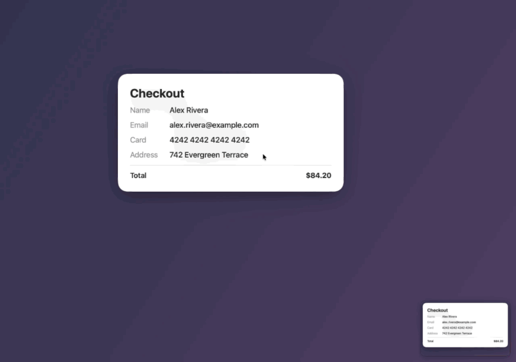

# PicClip

PicClip replaces the macOS screenshot preview. Instead of disappearing after a few seconds, the preview stays in the corner of your screen until you're done with it.

Take a screenshot like you normally would (⇧⌘3 or ⇧⌘4) and it shows up in the corner:


### Drag it into any app
Drag the preview into Messages, Slack, Discord, your browser, or anywhere else that takes images. Once you drop it, the preview goes away.


### Copy, pin, or close it
Hover over the preview to copy it, pin it, or close it. A pinned screenshot floats on top of all your windows, so you can keep it in view while you work. You can drag it wherever you want.


### Mark it up and hide private info
Click the preview to open it in the library. You can draw on it with the marker, or black out, blur, or pixelate anything you don't want people to see, then save.

Blur and pixelate are fine for most things, but use black out for anything that's actually sensitive.



<p align="center">
  <br>
  
</p>

If you quit PicClip, the normal macOS preview comes back.

## Install
PicClip needs macOS 15 or later and works on both Apple Silicon and Intel Macs. The easiest way to install it is to paste this into Terminal:

```sh
curl -fsSL https://github.com/Sl0oth/PicClip/releases/latest/download/PicClip.zip -o /tmp/PicClip.zip \
  && ditto -xk /tmp/PicClip.zip /Applications && open /Applications/PicClip.app
```

That downloads the latest version, puts it in your Applications folder, and opens it. After that, turn on Launch at Login from the menu bar icon so it's always running.

<details><summary>Don't want to use Terminal?</summary>

Download `PicClip.zip` from [Releases](https://github.com/Sl0oth/PicClip/releases/latest), unzip it, and drag PicClip into your Applications folder.

The first time you open it, macOS will say it can't verify the app. That's because Apple charges $99 a year to verify apps, and PicClip is free. To open it anyway, go to **System Settings → Privacy & Security**, scroll down, and click **Open Anyway**. You only have to do this once.
</details>

## Updates
PicClip checks for updates once a day. You can also check yourself with **Check for Updates…** in the menu. When a new version is out, click **Install & Relaunch** and you're done.

## Building it yourself
```sh
./build.sh run                 # build and open the app
scripts/make-signing-cert.sh   # run once so permissions don't reset after every build
./release.sh 0.2.0 "notes"     # publish a new version on GitHub
```

| Path | What's there |
| --- | --- |
| `Sources/PicClip/` | The app (Swift) |
| `Resources/Info.plist` | App settings |
| `Resources/Icon/` | The icons. Run `make-icon.sh` after changing them. |
| `build.sh` | Builds and signs the app |
| `release.sh` | Publishes a release (the app updates from these) |
| `scripts/make-signing-cert.sh` | One-time signing setup |
| `scripts/demo/record.sh` | Re-records the GIFs at the top of this page |

## License
PicClip is licensed under [GPL-3.0](LICENSE). You can use it, read the code, change it, and share it. If you release your own version, you have to keep my copyright notice and release your code under GPL-3.0 too.

The PicClip name and logo aren't covered by the license, so if you fork it, please use a different name and icon.

Copyright © 2026 Sl0oth
