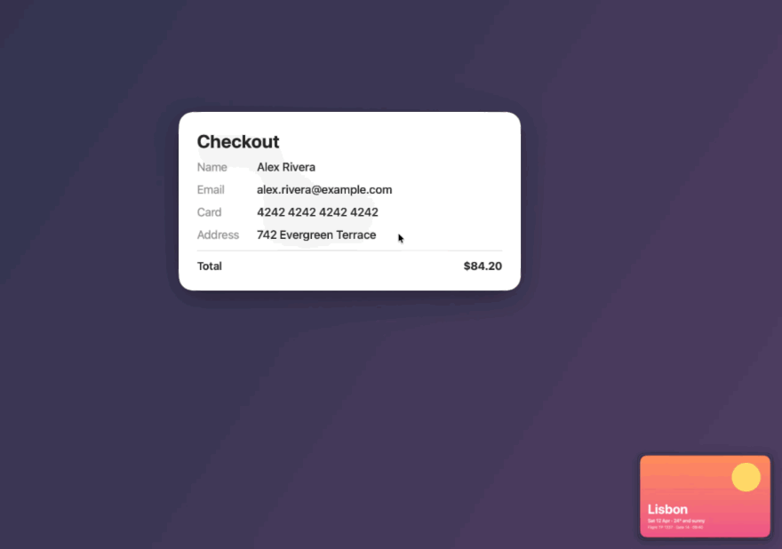
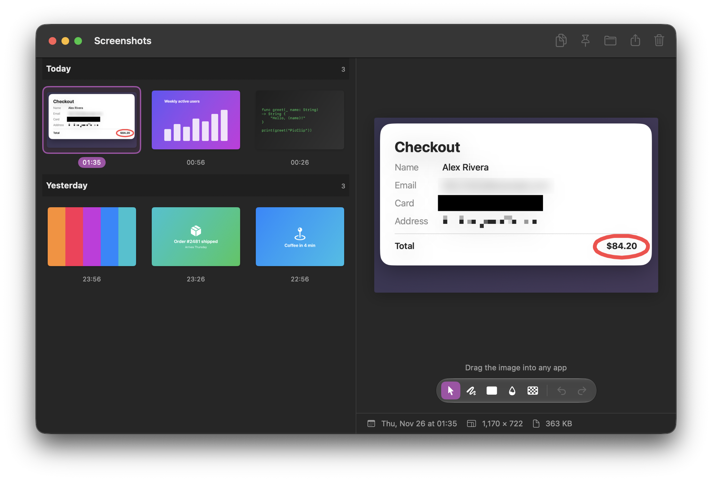
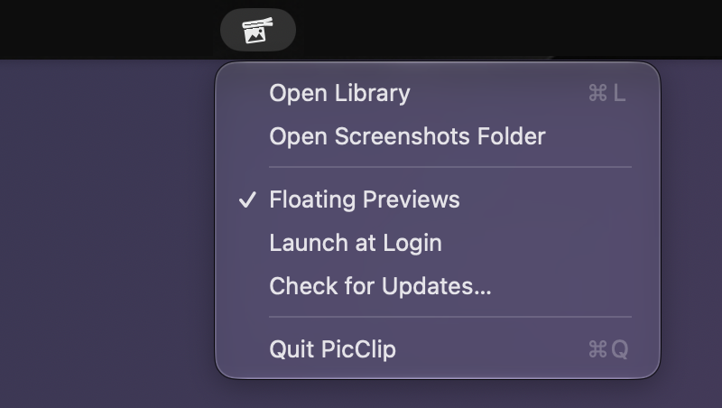

# PicClip

A tiny macOS menu bar app that replaces the screenshot thumbnail that vanishes after a few seconds with one that **stays put** until you're done with it.

Take a screenshot (⇧⌘3 / ⇧⌘4) and a preview clips itself to the corner of your screen, and stays there:


### Drag it anywhere
Drag the preview into any app (Messages, Slack, Mail, a browser) to drop the image in.


### Pin it on top
Hover for **Copy**, **Pin**, and **✕**. A pinned screenshot floats above every window; drag it around, close it when you're done.



### Mark it up, hide what's private
Click the preview to open the library. Draw with the **marker**, **black out** card numbers and passwords, **blur** or **pixelate** anything else, then save.


<p align="center">
  <br>
  
</p>

Quitting PicClip gives you back the normal macOS thumbnail.

## Install
macOS 15 or later, Apple Silicon or Intel. Paste this into Terminal:

```sh
curl -fsSL https://github.com/Sl0oth/PicClip/releases/latest/download/PicClip.zip -o /tmp/PicClip.zip \
  && ditto -xk /tmp/PicClip.zip /Applications && open /Applications/PicClip.app
```

It downloads the latest release, unzips it into Applications, and opens it. Then turn on **Launch at Login** from the menu bar icon.

<details><summary>Prefer downloading it yourself?</summary>

Grab `PicClip.zip` from [Releases](https://github.com/Sl0oth/PicClip/releases/latest), unzip it, and drag PicClip into Applications.
PicClip isn't notarized by Apple (that costs $99/year), so the first launch shows a warning. Open **System Settings → Privacy & Security**, scroll down, and click **Open Anyway**. You only do this once.
</details>

## Updates
PicClip checks GitHub for new releases once a day (or use **Check for Updates…** in the menu). Click **Install & Relaunch** and you're done.

## Develop
```sh
./build.sh run                 # build build/PicClip.app and launch it
scripts/make-signing-cert.sh   # once: free self-signed cert, so permissions + updates survive rebuilds
./release.sh 0.2.0 "notes"     # bump version, build, tag, publish a GitHub release
```

## Project layout
| Path | What |
| --- | --- |
| `Sources/PicClip/` | The app (Swift, AppKit + SwiftUI) |
| `Resources/Info.plist` | Bundle settings |
| `Resources/Icon/` | Icon sources (`AppIcon.svg`, `MenuBarIcon.svg`); run `make-icon.sh` after editing |
| `build.sh` | Builds and signs the `.app` |
| `release.sh` | Publishes a release to GitHub (the in-app updater reads these) |
| `scripts/make-signing-cert.sh` | One-time signing certificate setup |

## License
Copyright © 2026 Sl0oth. PicClip is free software under the [GNU GPL v3](LICENSE): you can use, study, change, and share it, but any version you distribute must keep this notice and be released under GPL-3.0 with its full source.

The PicClip name and logo are not covered by the GPL. Forks must use a different name and icon.
